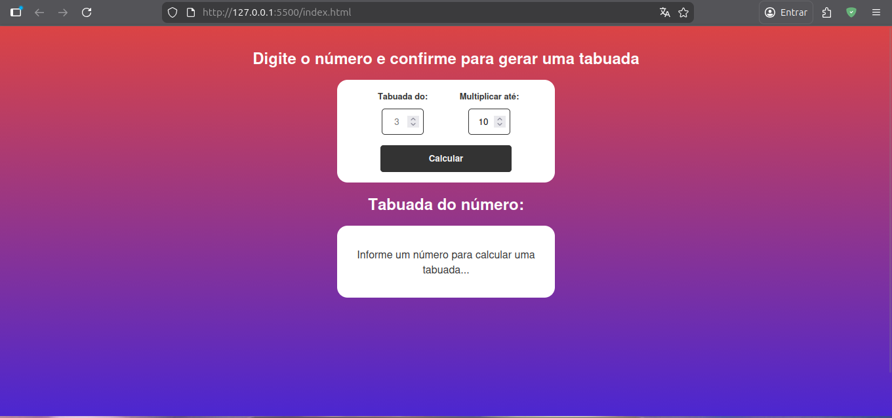
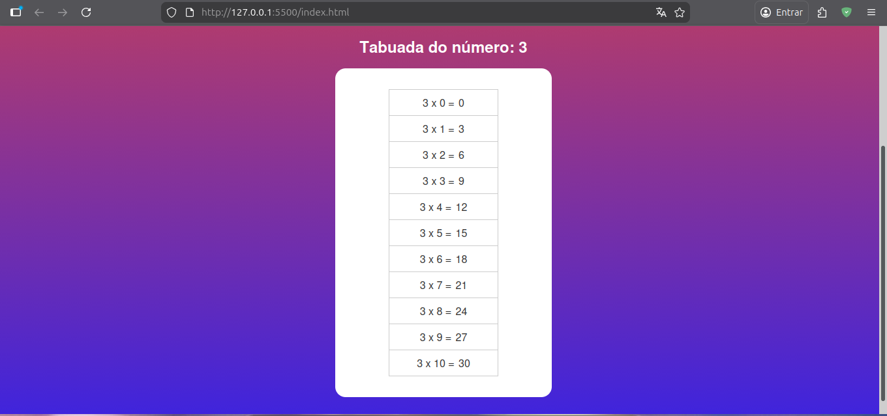
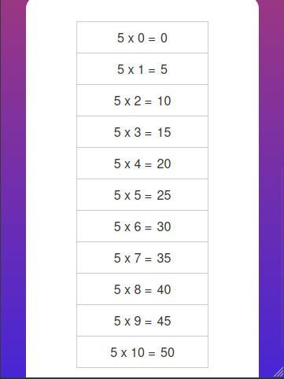

# Multiplication Table Project

A simple and interactive multiplication table generator built with modern web technologies.

## 🚀 Technologies Used

- **HTML5**: Semantic structure of the application.
- **CSS3**: Modern styling with a clean and responsive design.
- **JavaScript**: Core logic for generating the multiplication table dynamically.

## 📂 Project Structure

Below is the directory structure of the project (excluding the `.github` folder):

```text
.
├── assets
│   ├── css
│   │   └── styles.css
│   └── js
│       └── scripts.js
├── index.html
└── README.md
```

## 🛠️ How to Run the Project

### 1. Using Live Server (Recommended)

If you are using **Visual Studio Code**, you can use the **Live Server** extension for a better development experience:

1. Open the project folder in VS Code.
2. Install the **Live Server** extension if you haven't already.
3. Right-click on `index.html` and select **"Open with Live Server"**.
4. The project will automatically open in your default browser at `http://127.0.0.1:5500`.

### 2. Without Live Server

You can also run the project by simply opening the `index.html` file:

1. Navigate to the project folder on your computer.
2. Double-click the `index.html` file.
3. It will open in your default web browser.

## 🖼️ Previews

### Desktop Version




### Mobile Version



